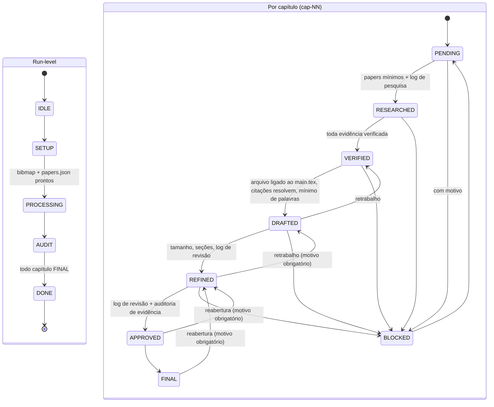

# Pesquisa e escrita do TCC

O texto do TCC vive em `$TCC_HOME` (default `~/tcc`), um repositório separado deste. Esta skill
governa como um capítulo sai de "não escrito" para "FINAL", e nenhum capítulo é escrito direto:
a ordem das fases é decidida pelo motor, não pelo modelo.

## Escopo e caminhos

| Caminho (relativo a `$TCC_HOME`) | Papel |
|---|---|
| `planejamento/papers.json` | registro de fontes (chave = URL) |
| `planejamento/chapters.json` | configuração dos capítulos e mínimos |
| `planejamento/bibmap.json` | citekey → paper → registro de evidência |
| `evidencias/papers/*.json` | registro de verificação por fonte |
| `evidencias/capitulos/cap-NN.md` | log de pesquisa do capítulo |
| `evidencias/revisao/cap-NN.md` | log de revisão do capítulo |
| `referencias.bib` | entradas BibTeX |
| `capitulos/*.tex` | capítulos |
| `main.tex` | raiz do documento |
| `scripts/statecraft.mjs`, `scripts/state.mjs`, `scripts/tcc-definition.mjs` | motor e CLI |
| `tcc.state.json` | estado persistente da sessão `tcc` (ignorado pelo git) |

Toda execução começa com `cd "$TCC_HOME"`.

## Máquina de estados



## Comandos

```bash
node scripts/tcc-bootstrap.mjs                 # idempotente; avança só até onde os guardas deixam
node scripts/state.mjs lint
node scripts/state.mjs status --session tcc --full
node scripts/state.mjs status --entity cap-15 --session tcc

node scripts/state.mjs transition RESEARCHED --entity cap-15 --session tcc
node scripts/state.mjs transition VERIFIED   --entity cap-15 --session tcc
node scripts/state.mjs transition DRAFTED    --entity cap-15 --session tcc
node scripts/state.mjs transition REFINED    --entity cap-15 --session tcc
node scripts/state.mjs transition APPROVED   --entity cap-15 --session tcc
node scripts/state.mjs transition FINAL      --entity cap-15 --session tcc

node scripts/state.mjs validate REFINED --entity cap-15 --session tcc   # sem mutar
node scripts/state.mjs transition BLOCKED --entity cap-15 --session tcc \
  --data '{"reason":"sem fonte peer-reviewed para X"}'
node scripts/state.mjs transition DRAFTED --entity cap-15 --session tcc \
  --data '{"reason":"parágrafo 3 exagerou a fonte"}'
```

## Contratos de fase

| Fase | Subagente | Escreve | Exigido antes da transição |
|---|---|---|---|
| RESEARCHED | `tcc-researcher` | `evidencias/capitulos/cap-NN.md`, `papers.json` via script | papers mínimos; log com `## Question`, `## Selected sources`, `## Discarded` |
| VERIFIED | `tcc-verifier` | `evidencias/papers/*.json`, `referencias.bib`, `bibmap.json` | toda fonte com `verified: true` e `claim_support` em {sim, parcial} |
| DRAFTED | `tcc-writer` | `capitulos/*.tex`, `main.tex` | arquivo existe, `\chapter`, `\label{cap:...}`, citações resolvem, sem TODO, mínimo de palavras |
| REFINED | `tcc-editor` | `capitulos/*.tex` | mínimo de palavras, ≥ 2 `\section`, log de revisão sem item desmarcado e `Verdict: approve` |
| APPROVED / FINAL | `tcc-reviewer` | `evidencias/revisao/cap-NN.md` | `Flags considered: yes` e `Evidence audit: pass` |

A tabela é um resumo. `scripts/tcc-definition.mjs` é a autoridade: nunca enfraqueça um guarda
para a transição passar.

## Regras duras

1. Nunca editar `capitulos/*.tex` fora de VERIFIED, DRAFTED ou REFINED. O plugin `tcc-gate`
   bloqueia.
2. Nunca citar chave ausente de `referencias.bib` **e** de `planejamento/bibmap.json`.
3. Nunca criar entrada de bib para fonte não registrada em `papers.json` com evidência
   verificada.
4. Editar um capítulo REFINED o rebaixa a DRAFTED. Refine de novo antes de pedir aprovação.
5. **Negativa de transição é um achado.** Corrija o repositório e tente de novo. Nunca
   `--force`, nunca editar `tcc.state.json` à mão, nunca apagar evidência para o guarda passar.
6. `FINAL` é estável, não editável. Para corrigir, reabra com motivo:
   `transition REFINED --data '{"reason":"..."}'`.

## Verificação de fato

O protocolo completo está em `references/evidence-protocol.md`. Resumo:

- só fonte peer-reviewed (trilha principal, Findings, periódico ou workshop revisado);
  preprint, relatório técnico e blog não sustentam alegação — a documentação do MCP é a única
  exceção;
- `verified: true` exige **citação literal** com seção/página; sem trecho, não está verificado;
- `claim_support: "nao"` bloqueia a citação;
- `claim_adjusted` é a única frase que o redator pode usar;
- `flags` são obrigações do texto, não decoração: se a fonte não testou agentes, o capítulo diz
  isso.

## Redação

As regras completas estão em `references/writing-rules.md`. Resumo:

- o texto da tese é em **inglês**; planejamento e conversa em português;
- cada frase factual é (a) sustentada por fonte verificada, (b) **formalização deste trabalho**
  — dita explicitamente, ou (c) **inferência** — marcada e ligada a um experimento;
- nada fora dessas três categorias;
- passar de REFINED exige auditoria de alegação, estrutura, compressão de 10–20%, precisão,
  LaTeX e build limpo.

## Subagentes

Os cinco papéis estão em `.claude/agents/`:

| Arquivo | Papel |
|---|---|
| `tcc-researcher.md` | encontra e registra fontes |
| `tcc-verifier.md` | verifica cada alegação contra o PDF |
| `tcc-writer.md` | redige o capítulo e liga ao `main.tex` |
| `tcc-editor.md` | refina sem adicionar alegação |
| `tcc-reviewer.md` | audita e emite veredito |

Despache um por vez, sempre com número, arquivo e estado explícitos no prompt. Dois escritores
no mesmo capítulo ao mesmo tempo corrompem o estado.

## Sessão paralela

Capítulos diferentes são entidades diferentes da mesma sessão. Subagentes podem trabalhar em
paralelo **desde que** passem `--session tcc` e toquem só a própria entidade. O mesmo capítulo,
nunca.

## Recuperação

```bash
node scripts/state.mjs list-sessions
node scripts/state.mjs status --session tcc --full
node scripts/tcc-bootstrap.mjs     # reconstrói a partir dos fatos do repositório
```

O estado é reconstruível: os guardas leem os arquivos reais. Perder `tcc.state.json` perde
histórico, não verdade.